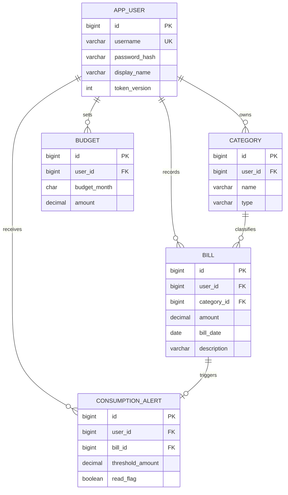

# 第一阶段 需求与数据库设计

项目：基于 Spring Boot 与 Vue 的智能个人记账与消费分析系统。组名：酱味大鸡。
王天昊（241310124）负责后端、数据库与算法；庞润泽负责前端与图表。

## 范围与验收
1. 用户管理：注册、登录、退出、个人信息修改；凭 JWT 识别用户。
2. 账单：收入/支出增删改查和分页，金额、日期、描述及类别完整。
3. 分类：共享默认类别和个人自定义类别；不能改删默认类别或他人类别。
4. 统计：月度收入/支出/结余、分类占比和连续月份趋势，空月份补零。
5. 预算：每人每月一条正数预算；达到80%为接近上限，达到100%为超支预警。
6. 分类推荐：描述关键词匹配，仅建议，用户确认后保存账单。
7. 异常检测：同一用户过去90天的先前支出样本，最少8条，IQR上界检测。

## 架构
Vue 3 / Axios → Spring Security JWT过滤器 → REST控制器 → 业务服务 → MyBatis-Plus → MySQL 8。
前端通过HTTP交互；所有归属判断使用已认证用户ID，不采信请求中的用户ID。

## ER图

## 数据约束
金额为DECIMAL(12,2)，允许0.01至9999999999.99；不能用浮点累计。
category.user_id为空表示默认类别。个人类别按(user_id,name,type)唯一，服务层检查与默认类别重名。
分类被账单引用时不可删除，已有账单时不可改变收支类型。
预算按(user_id,budget_month)唯一。异常提醒按bill_id唯一，删除账单级联清理。
用户名统一小写ASCII，密码使用BCrypt；数据库不保存明文密码或JWT。
token_version用于持久化退出失效：退出会使该用户全部已有令牌失效。
脚本用于新建数据库，重复执行建表应报错，避免静默覆盖已有数据。

## 阶段依赖
阶段1交付表结构、工程和契约；阶段2实现核心流程；阶段3接入算法及提醒；阶段4验证和交付。
前端实联调与课堂答辩由双方后续共同执行，不能以接口测试替代其完成记录。
