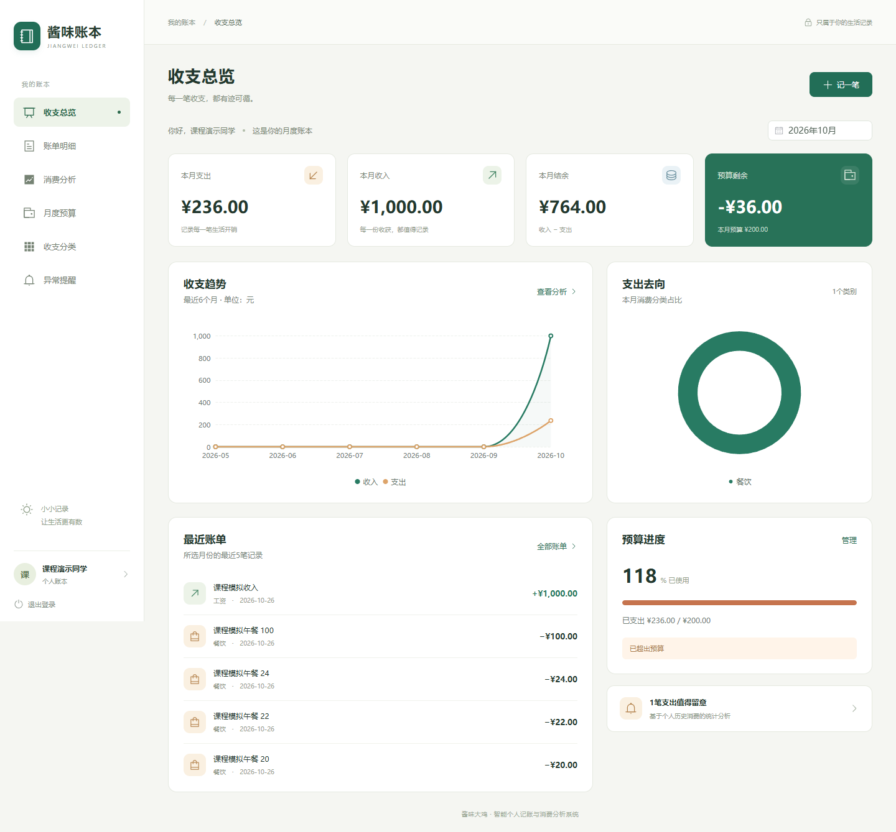
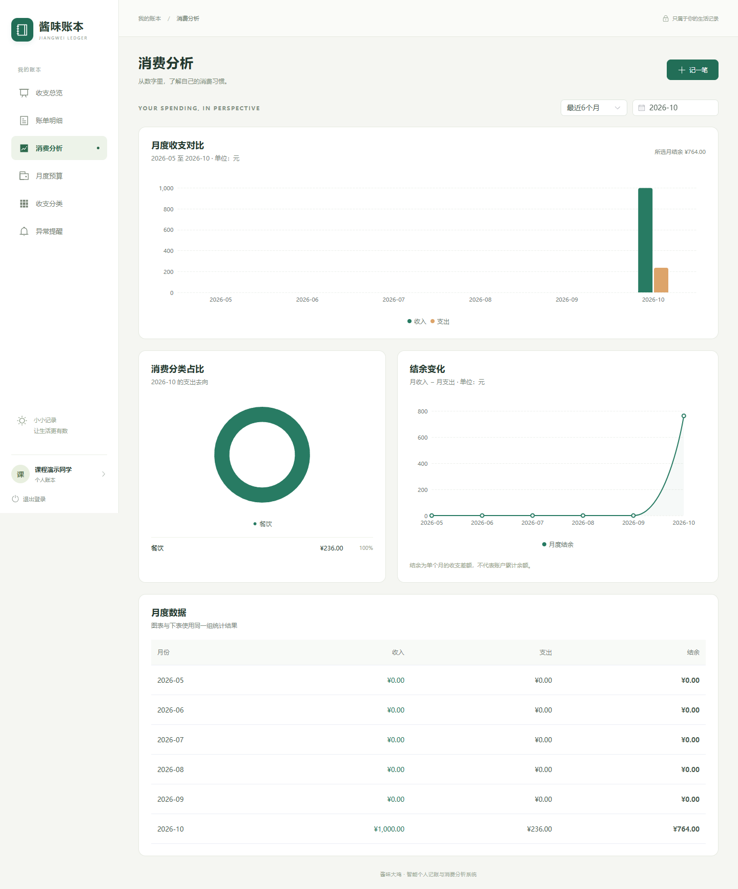
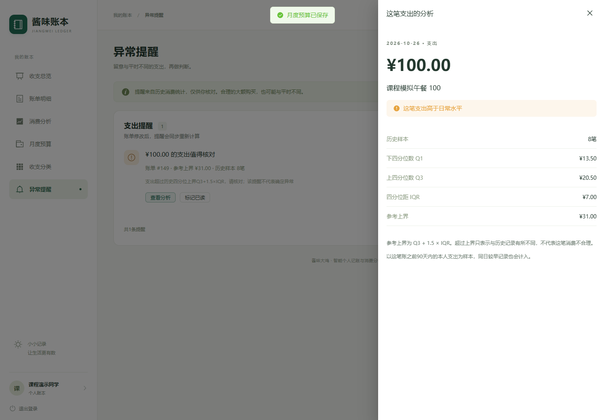

# 酱味账本用户操作说明

本系统用于课程演示和个人模拟记账。请先按README启动前后端，使用人工构造的账单。

## 账户与个人信息

进入登录页选择“注册”，输入3至32位字母、数字或下划线用户名、显示名称和8至64位不含空格的英文字符密码。注册成功后自动登录。用户名不能修改，点击左下角头像可修改显示名称。
“退出登录”需要确认，并使该账号其他会话也需要重新登录。登录过期后页面会提示重新登录；成功后返回原目标页面。

## 记录和查询账单

点击“记一笔”或账单明细中的“新增账单”，选择收入/支出，输入正金额（最多两位小数）、不晚于今天的日期、分类和描述，点击保存。
输入“学校食堂午餐”等描述后可点“智能推荐分类”，查看推荐及匹配关键词。点“采用建议”只填写类别，仍须点“保存账单”。未匹配时自行选类。切换类型会清空原分类。
账单列表可按描述关键词、收支类型、类别和日期范围组合查询，点击“重置”恢复全部记录。支持分页及每页条数调整。编辑后保存立即刷新列表；删除前显示确认提示，删除后统计和提醒会重算。
手机端列表可以横向滚动查看右侧金额和操作，导航通过顶部按钮展开。

## 分类管理

系统默认分类只供选择，不提供修改或删除。自定义分类可新增、改名或删除。重复名称会收到错误提示。已经用于账单的分类不可直接删除，需先调整相关账单；已引用的分类不可改变收支类型。

## 总览与消费分析

总览显示所选月的收入、支出、结余和预算剩余，以及最近5笔账单。结余=月收入−月支出，属于当月差额，不是累计账户余额。
消费分析支持6或12个月范围：柱状图比较收支、饼图显示所选月支出类别占比、折线图显示结余变化。下方月度表格与图表共享接口结果。没有支出时显示空状态，空月份在趋势中为0。

## 预算和异常提醒

月度预算只按当月支出计算使用率，收入不抵减。达到80%显示接近上限，达到100%显示已用完，超过100%显示超支。修改账单后重新进入页面可查看最新进度。
异常提醒使用该笔账之前90天的本人支出，至少8笔。页面显示样本量、Q1、Q3、IQR及上界。金额超过Q3+1.5×IQR时提示核对，可查看分析和标记已读。样本不足时明确说明，不武断判断。异常不等于消费不合理。

## 常见问题

页面提示连接失败：确认后端已启动，数据库可连接，API_TARGET正确，点击“重新加载”。
看不到演示数据：先确认登录账号，再选正确月份；旧SQL样例固定在2026年10月，新演示脚本用运行当天。
保存失败：检查金额、分类类型和日期，按显示的原因修正。401需要重新登录，403/404不能据此前往其他用户数据。
图表空白：先确认接口成功且有记录。图表随容器自动缩放，浏览器过窄可滚动查看表格。
